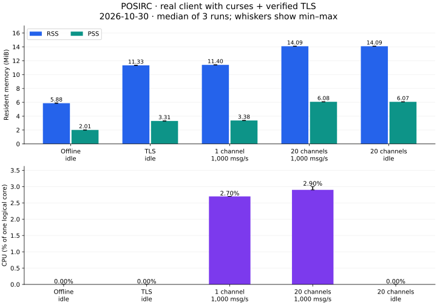
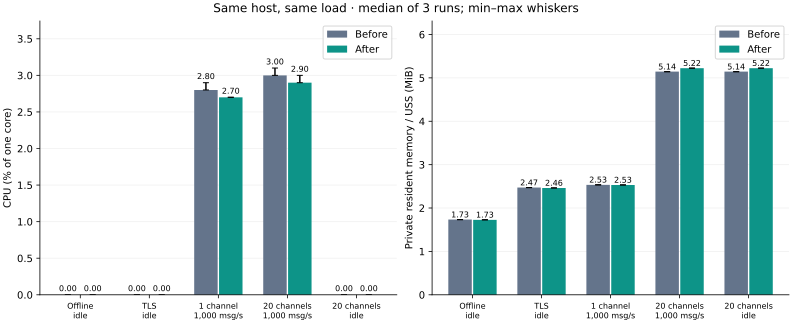
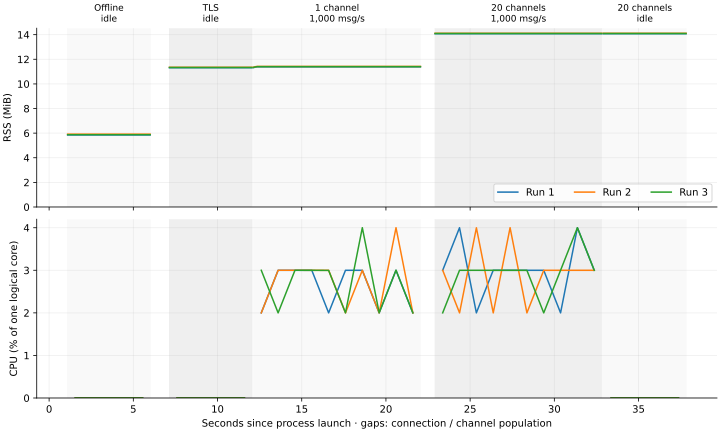
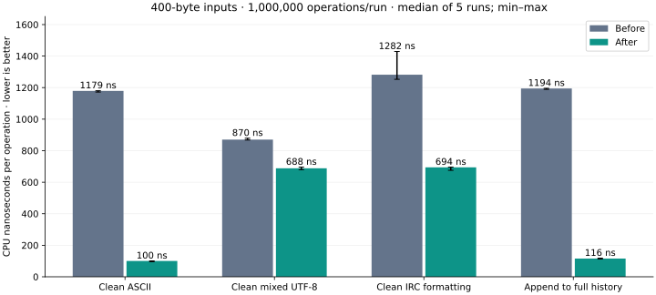
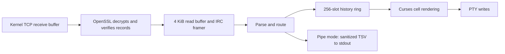

# POSIRC

POSIRC is a small IRC client written in C99, using POSIX APIs, curses and
OpenSSL. Use it interactively in a terminal, send text from a Unix pipeline, or
stream channel messages into another program. Every connection uses verified TLS.

The terminal interface provides separate conversation buffers, channel user lists,
UTF-8 editing and IRC colors. Memory use is bounded, histories allocate only as
needed, and the client requires no scripting runtime.

POSIRC is licensed under **GPL-3.0-only**. See [LICENSE](LICENSE). This license
also applies to the already published `v0.3.0-beta.1` source and POSIRC binaries;
third-party dependencies retain their own licenses.

```sh
# Interactive client
./posirc -s irc.azzurra.chat -p 6697 -n mynick -j '#canaletest'

# Send a line and exit
printf '%s\n' 'blabla' | ./posirc -s irc.azzurra.chat -n mybot -j '#canaletest'

# Receive channel messages as nickname<TAB>text
./posirc -o -s irc.azzurra.chat -n mylogger -j '#canaletest' </dev/null | tee channel.tsv
```

Use an available nickname and a channel you can join. Port 6697 is the default.

[Build](#requirements-and-build) · [Connect](#connect) ·
[Unix pipelines](#unix-pipelines) · [Commands and keys](#commands-and-interface) ·
[Measured resource use](#measured-resource-use) · [Limits](#verification-and-current-limits)

## Beta downloads

The current prerelease is [v0.3.1-beta.2](https://github.com/vash909/POSIRC/releases/tag/v0.3.1-beta.2).
Every binary in the release passes unit, configuration, real curses rendering,
local TLS 1.2/1.3 and real CLI pipe tests on its target ISA and operating system.

| System | CPU targets | Runtime libraries |
| --- | --- | --- |
| Linux / musl | x86-64, x86 (i686), ARM64 LE/BE, ARMv7 LE/BE, ARMv6, RISC-V 32/64, PowerPC 32 BE and 64 BE/LE, s390x, MIPS32 LE/BE, MIPS64 N32 LE/BE, MicroBlaze LE/BE, OpenRISC, SuperH LE/BE, m68k, Hexagon | Static executable with OpenSSL and wide ncurses embedded |
| Linux / glibc | Alpha, PA-RISC, SPARC64, MIPS64 N64 LE/BE | glibc 2.39+; OpenSSL and wide ncurses embedded |
| Linux / uClibc-ng | SPARC V8, SPARC32PLUS, Xtensa dc233c LE | Static executable with OpenSSL and wide ncurses embedded |
| Linux / openEuler 24.03 LTS SP4 | LoongArch64 | Distribution glibc, OpenSSL and ncurses packages |
| macOS 15+ | Apple Silicon / ARM64, Intel / x86-64 | Apple system libraries; OpenSSL and ncurses embedded |
| FreeBSD 14.4 | x86-64, ARM64, RISC-V 64, PowerPC 64 BE | Base-system libraries |
| OpenBSD 7.9 | x86-64, ARM64, RISC-V 64, SPARC64 | Base-system libraries, including LibreSSL |
| NetBSD 10.1; 11.0 for RISC-V | x86-64, ARM64, SPARC64; RISC-V 64 | Base-system libraries |
| DragonFly BSD 6.4.2 | x86-64 | Base TLS; install the `ncurses` package |
| MidnightBSD 4.0.8, GhostBSD 26.2, HardenedBSD 15, OPNsense 26.7 | x86-64 | OS libraries |
| NextBSD continuous | x86-64 | OS libraries; rolling snapshot recorded in build metadata |
| Solaris 11.4 | x86-64 | OS OpenSSL and ncurses packages |
| illumos: OmniOS r151058, OpenIndiana 202604, Tribblix 0m41.1 | x86-64 | OS packages; OpenIndiana uses OpenSSL 3 |
| GNU Hurd 2025 | x86-64, i386 | Distribution glibc, OpenSSL and ncurses packages |
| Haiku r1beta6 | x86-64 | OS libraries plus `openssl3` and `ncurses6` packages |

Download the `.tar.gz` matching both **OS and CPU/ABI**, verify it against
`SHA256SUMS`, extract it, and run `./posirc --version`. Each archive includes the
GPL license, installation instructions and `BUILD-INFO.txt`; dynamically linked
packages also list their runtime dependencies. CA certificates and terminal
descriptions remain necessary. Use `-c /path/to/ca-bundle.pem` when needed.
Embedded library updates require installing a newer POSIRC binary.

`x86` requires i686-class hardware with CMOV and SSE2, not an original 80386.
MIPS N32 and N64 use different pointer sizes and calling conventions; PowerPC
and ARM byte order matters too. Xtensa CPU configurations are not interchangeable.
See the [CPU/ABI details and validation boundaries](docs/releases/PORTABILITY.md)
and [installation instructions](docs/releases/INSTALL.txt) before choosing a package.
macOS binaries are ad-hoc signed, not Apple notarized.

Linux x86-64/ARM64 and both macOS builds use native runners; Linux x86 uses
compatibility mode. Other Linux executables run under QEMU user emulation;
BSD, Solaris/illumos, Hurd, Haiku and LoongArch builds execute in full-system VMs.
The same client features are present in every package. Emulation establishes
that the tests execute; it does not certify every physical CPU, kernel or terminal.

The [release workflow](.github/workflows/release.yml) builds without publication
with `workflow_dispatch`, `publish=false`. Publication requires every job in the
[release manifest](scripts/release-targets.json) and the archive verification job
to pass. CI verifies the exact target set and source commit, packages the tested
executables and matching source, uploads a draft, then publishes the complete beta.
Actions, SDK checksums, dependency source checksums and the additional QEMU
package are pinned. OS package repositories can receive security updates;
actual compiler/library versions are recorded in each archive.

If publication fails after validation, dispatch with `publish=true` and
`reuse_run` set to the original release run ID. CI verifies the complete original
job set and each archive's revision before publishing those exact artifacts.
See the [release notes](docs/releases/v0.3.1-beta.2.md) for changes since the first beta.

## Arch Linux package

The source package builds `v0.3.0-beta.1` as `0.3.0beta1-1`, under
`GPL-3.0-only`. To build the recipe in this repository, install `base-devel`,
then run:

```sh
cd packaging/aur
makepkg -si
posirc --version
```

Review [PKGBUILD](packaging/aur/PKGBUILD) before building. It verifies SHA-256
checksums, respects your `makepkg.conf` compiler/linker flags, and runs the unit,
curses, local TLS and CLI pipe tests. Tests need loopback sockets and a UTF-8
locale. The installed executable links dynamically to Arch's OpenSSL and ncurses;
`pacman` manages those dependencies and the CA certificates. Documentation and
benchmark figures are installed in `/usr/share/doc/posirc/`.

The recipe permits `x86_64`, `i686`, `aarch64`, `armv7h`, `armv6h` and `riscv64`
for Arch and compatible derivatives with the required packages. The AUR package
has been built and tested locally on x86-64; the release CI matrix above describes
separate upstream portability tests, not AUR builds on every architecture.

## Requirements and build

- A C99 compiler, POSIX-compatible make and a shell.
- The system C library and a wide-character X/Open Curses implementation, such as ncursesw.
- OpenSSL headers and libraries exposing the 1.1.1 API or later. Use a maintained
  OpenSSL release; tested versions include 3.5.7 and 3.6.5.
- For the interactive UI: a terminal with a valid `TERM`, terminal descriptions
  and a UTF-8 locale. Pipe modes need no terminal or `TERM`.
- A system CA store, or an explicit PEM CA file supplied with `-c`.

On Debian/Ubuntu, the usual build packages are `build-essential`,
`libncurses-dev` and `libssl-dev`; on Arch Linux, `base-devel`, `ncurses`
and `openssl`. A `ca-certificates` package normally supplies public trust roots.
There is no dependency on CMake, Autotools, pkg-config, Python or an application
thread library. The client and test programs are C.

```sh
make
make test
make ui-test
make integration-test
./posirc
```

`make test` runs unit tests without a terminal or network access.
`make ui-test` checks the real curses cells using `xterm-256color` and `vt100`
terminal descriptions and temporary streams; it needs a UTF-8 locale but no
interactive terminal.
`make integration-test` creates temporary certificates and local TLS servers on
loopback using ephemeral ports. It needs permission to create sockets and fork
processes; it never contacts an external IRC server. It also runs the real CLI
with redirected stdin/stdout to check pipe modes, streaming and failure exits.

The default build links `-lncursesw -lssl -lcrypto`. On systems with different
library names or installation paths, override make variables:

```sh
make clean
make CC=cc CPPFLAGS='-Iinclude -I/opt/openssl/include' \
    LDFLAGS='-L/opt/openssl/lib' CURSES_LIBS='-lncursesw' \
    TLS_LIBS='-lssl -lcrypto'
```

Some systems expose wide curses through `-lcurses` instead. On macOS with
Homebrew, install `openssl@3` and `ncurses`, then supply their include/library
paths using `CPPFLAGS` and `LDFLAGS`.

Preserve `-Iinclude` when replacing `CPPFLAGS`. Some older Unix systems need
`LDLIBS=-lrt` for `clock_gettime`. The Makefile uses POSIX syntax. Clean before
changing compilers or flags, because make does not track variable values.
For GCC or Clang development builds:

```sh
make clean
make all test tests/test_net \
    CFLAGS='-std=c99 -O0 -g -Wall -Wextra -Wpedantic -Werror'
make integration-test
```

## Connect

The interactive client remembers the last server, TLS port and nickname in
`$HOME/.posirc`, a small editable text file:

```text
server=irc.azzurra.chat
port=6697
nick=tuonick
```

Launching `./posirc` reuses these values and connects to the saved server.
Explicit `-s`, `-p` and `-n` options take precedence. The latest values, including
changes made with `/connect` and `/nick`, are saved when the TUI exits normally
or handles a termination signal. Saving replaces the file through a temporary
file; a forced kill cannot save. A missing file uses the usual defaults.
Without `HOME`, persistence is unavailable on any platform.

The file parser copies known values into existing fields without semantic
validation. Values are bounded by those fields; the saved nickname is shortened
to **15 Unicode characters**. Explicit `-n` and `/nick` choices longer than 15
characters are rejected. This limit applies to your chosen nickname, not other
users' nicknames or WHOIS targets. Existing IRC/network checks remain in place.
Pipelines keep using explicit arguments and neither read nor write this file.
No settings watcher or additional persistent configuration buffer is needed.

Replace `irc.example.net` with your server:

```sh
./posirc -s irc.example.net -p 6697 -n yournick -j '#channel'
```

Or start `./posirc` and enter:

```text
/nick yournick
/connect irc.example.net
/join #channel
hello everyone
```

Wait for registration before `/join`. The target switches to the channel after
the server confirms your JOIN. Ordinary text goes to the target shown in the
status line. A local `[queued]` echo means the message entered the send queue. The marker
disappears once the complete frame has been written through TLS; pending echoes
become `[unsent]` if the connection closes first. Neither state confirms delivery
to recipients. Server errors remain visible in the transcript.

`-s` connects on startup; without it, POSIRC stays offline until `/connect`.
`-p` sets the startup port (default 6697); `/connect` takes its own optional port.
`-n` overrides the nickname (saved TUI value, otherwise `posirc`), and `-j` joins one channel after each
successful registration. Quote channel names in shell commands.
`--help` and `--version` work without a terminal.

For a private CA:

```sh
./posirc -s irc.example.net -n yournick -c /path/to/trusted-ca.pem
```

The CA file replaces the default OpenSSL trust paths for every connection in
that process. The server must still present a valid certificate for the exact
hostname or IP address used to connect.

## Unix pipelines

| Input / option | Behavior |
| --- | --- |
| Terminal stdin, no `-o` | Interactive curses interface |
| Pipe or file on stdin | Send each nonempty line to `-j channel`, then exit at EOF |
| `-o` | Stream received channel messages to stdout and stay connected |
| Pipe or file on stdin plus `-o` | Send and receive; keep listening after stdin EOF |

Both pipe modes require `-s server` and `-j channel`. `-n` selects the nickname,
`-p` the port (default 6697), and `-c` an optional private CA file.
`-c` is **not** a channel flag. Quote channel names so the shell does not treat
`#` as the start of a comment. Use `|` to connect processes: `>> ./posirc` would
append to the executable file, not run the client.

Send multiple lines or a file:

```sh
printf '%s\n' 'build started' 'build finished' |
    ./posirc -s irc.azzurra.chat -n buildbot -j '#canaletest'

./posirc -s irc.azzurra.chat -n buildbot -j '#canaletest' < report.txt
```

POSIRC waits for TLS verification, IRC registration and confirmation of its own
JOIN before reading messages from stdin. Each nonempty UTF-8 line becomes one
`PRIVMSG`; `/quit`, `/join` and other slash-prefixed lines are **literal text** in
pipe mode. LF and CRLF are accepted, as is a final line without a newline. Empty
lines are skipped. Embedded NUL/CR, invalid UTF-8 and oversized messages fail
with an error rather than being split or silently truncated. The 510-byte payload
limit includes `PRIVMSG`, the channel name and separators; multibyte UTF-8 counts
in bytes. Earlier valid lines may already have been sent when a later line fails.

Input buffering is fixed-size. When the outgoing queue fills, POSIRC stops
reading stdin until space is available, allowing backpressure to reach the
producer. It continues servicing server PINGs while waiting for input. There is
no automatic flood pacing: large inputs can still exceed a server's limits.

Without `-o`, EOF sends a final PING after the messages, waits for its matching
PONG, then sends QUIT and drains the TLS queue. Exit status 0 means this sequence
completed; it does **not** prove that every recipient saw or retained the messages.
TLS/network errors, IRC error replies (except a missing MOTD), rejected JOINs,
invalid input, failed output, interruption or timeouts return a nonzero status.
Registration has a 60-second timeout; JOIN, a stalled full queue and the final
PONG each have a 30-second limit. Waiting for a live stdin producer has no deadline.

Receive and filter messages:

```sh
./posirc -o -s irc.azzurra.chat -n mylogger -j '#canaletest' </dev/null |
    awk -F '\t' '$1 == "alice" { print $2; fflush() }'

# Send a live stream while logging incoming channel messages
tail -f application.log |
    ./posirc -o -s irc.azzurra.chat -n logbot -j '#canaletest' > channel.tsv
```

With `-o`, stdout contains only received `PRIVMSG` records for the selected
channel, formatted as `nickname<TAB>text<LF>` and flushed after each message.
IRC styling is removed; tabs and unsafe controls inside fields become `?`.
UTF-8 is preserved, with invalid incoming sequences replaced. Private messages,
other channels, notices and JOIN/PART events are excluded. Outgoing messages are
not locally echoed to stdout. CTCP payloads are sanitized as ordinary text.
Diagnostics go to stderr, so they do not enter the data pipeline.

`-o` keeps listening after stdin closes; use Ctrl-C or a signal to stop it.
When stdin is a terminal, `-o` receives only and does not read keyboard input.
For scripts, use `</dev/null` when there is nothing to send. A closed downstream
pipe is reported as an output error on the next write. Downstream programs may
need their own line-buffering options to display results immediately.

## Commands and interface

Commands are case-sensitive. There is one server connection, a server buffer,
and a separate history and input draft for every channel or query. Incoming
private messages create a query without stealing focus. An asterisk in the
conversation list indicates unread activity.

| Command | Action |
| --- | --- |
| `/connect host [port]` | Resolve and connect using verified TLS; reuse the last port, initially 6697 |
| `/nick nickname` | Set the offline nickname or request a nickname change |
| `/set [--quit text \| --part text \| --realname text \| --reset]` | View or change personal settings for this process |
| `/join #channel [key]` | Join a channel, selecting it on server confirmation |
| `/list [#channel]` | Request channels; results appear in `/buffer 0` |
| `/part [#channel]` | Leave a channel; defaults to the current target |
| `/query nickname` | Select a private-message target |
| `/whois nickname` | Request user details; results appear in `/buffer 0` |
| `/target name` | Select a channel or nickname; does not join a channel |
| `/msg target text` | Send to a target without changing the selected destination |
| `/me text` | Send a CTCP ACTION to the current channel or query |
| `/disconnect` | Send QUIT and disconnect, keeping POSIRC open |
| `/quit` | Send QUIT and exit |
| `/buffer number\|name` | Switch to an existing buffer (server is number 0) |
| `/buffers` | List buffers and unread counts |
| `/users` | Print the current channel user list |
| `/close` | Close the current query or a channel already left |
| `/clear` | Clear only the current history |
| `/help` | Show commands and keys |

Channels appear after your JOIN is confirmed. PART or KICK marks a channel as
`[left]`, clears its users and disables ordinary sending there, while retaining
its history until `/close`. Reconnecting to the same host and port retains
histories; connecting to a different endpoint clears conversation buffers so
messages from different servers cannot be mixed. Server status has its own
buffer. Nickname collisions remain visible; use `/nick anothername` to retry.

`/whois nickname` requests details for one nickname after registration. Results
go to the bounded server history without changing the selected buffer or opening
a private conversation. Common replies show user/host, real name, server,
channels, away/operator status, idle/sign-on time and account/TLS information when
the server supplies them. Errors and other server-specific replies remain visible
as raw numerics. Server rows use the same `***` clipping as `/list`. There is no
WHOIS cache or new persistent allocation. See the [WHOIS protocol](https://modern.ircdocs.horse/#whois-message).

Use one setting flag per command; everything after it is literal text, including
spaces, without shell quotes:

```text
/set --realname Nome Cognome
/set --quit A presto!
/set --part Ci vediamo dopo
/set
```

`/set` shows all three values; `/set --reset` restores defaults (`Leaving POSIRC`
for QUIT, no PART reason, `POSIRC client` as the real name). An empty `--quit` or
`--part` removes that reason. Reasons accept up to 255 UTF-8 bytes; the real name
requires 1–127 bytes. Oversized values are rejected without truncation. The real
name is the USER registration field, separate from the nickname: set it before
connecting; changing it during a connection takes effect at the next registration.
QUIT text applies to `/quit` and `/disconnect`, and PART text to `/part`.
Settings survive reconnects within this process and are not saved to disk.
`/nick` and the other existing IRC commands keep their direct syntax.

`/list` requests the server's channel list; `/list #channel` limits the request
to one channel. Results go to the server buffer without changing focus or
creating channel/user lists. The server history retains its latest 256 entries,
including list headers and other server events, so large lists overwrite older
results. Prefer a filtered request on large networks. Reply handling uses the
existing history ring with constant memory as the number of results grows.
Each server-buffer entry occupies one screen row: long entries are clipped with
`***` at the right edge, keeping channel names and topic beginnings visible.

A [reproducible LIST replay](benchmarks/list.c), measured with GCC 16.2.1 `-O2`
on a Ryzen 7 5800X (five runs, median process CPU time), gives:

| LIST replies | CPU time | Retained history allocation | New conversation/user entries |
| --- | --- | --- | --- |
| 256 | 0.054 ms | 17.5 KiB | 0 / 0 |
| 10,000 | 1.980 ms | 17.5 KiB | 0 / 0 |
| 100,000 | 19.736 ms | 17.5 KiB | 0 / 0 |

[Raw samples](docs/benchmarks/list.csv) include all five runs. The replay uses
fixed-length channel names and short UTF-8 topics; the allocation counts history
entry headers and reserved text bytes, excluding allocator overhead, fixed app
state and shared libraries. This is not process RSS or an end-to-end TUI/network
measurement: TLS and redraw costs are excluded. Longer topics require larger
ring slots, up to 256 entries of 1,024 text bytes plus entry headers. There is
no catalogue, per-channel allocation or sorting step; processing is linear in
the received bytes. Reproduce from the source root:

```sh
cc -std=c99 -O2 -Iinclude benchmarks/list.c \
    src/app.c src/buffer.c src/irc.c src/text.c src/net.c \
    -lssl -lcrypto -o /tmp/posirc-list-bench
/tmp/posirc-list-bench
```

The left sidebar lists channels and queries, and the right sidebar lists the
current channel's users with their highest known privilege prefix. User lists
follow NAMES, JOIN, PART, QUIT, NICK, KICK and MODE. PREFIX, CHANMODES,
CHANTYPES, STATUSMSG and CASEMAPPING are read from ISUPPORT. NAMES fragments are
merged with concurrent membership changes so stale names do not resurrect users
who have left. Topics appear above the conversation. PRIVMSG, NOTICE and CTCP
ACTION messages are routed to their channel/query.
Channel chat displays `<nick> message` (or `-nick- message` for notices); the
channel name appears in the header and buffer sidebar rather than on every line.

`/me waves` sends a CTCP ACTION and displays `* yournick waves` in the current
conversation. It uses the same bounded queue and `[queued]`/`[unsent]` transport
status as ordinary messages. The 512-byte IRC frame limit includes the ACTION
envelope; oversized actions are rejected before queueing. No CTCP catalogue,
automatic replies or additional persistent allocation is needed.

Sidebars hide on narrow terminals (buffers below 70 columns, users below 100).
The commands `/buffers`, `/buffer` and `/users` remain available. Long channel and
query messages wrap to the chat pane's width, including unbroken text. UTF-8, combining
marks and IRC styles are preserved across rows. PageUp/PageDown scroll visual
rows, including within a message taller than the pane; incoming messages retain
the paused history position. Resizing reflows the retained messages. Each message
is stored once in the same bounded history ring; wrapping allocates no copies or
per-row buffers. Labels, topics and drafts remain clipped to one row. Sidebar
separators are restored after pane content. A short terminal shows a size notice; ncurses
resize handling and terminal restoration are tested.

The server buffer uses one row per message, including `/list` results. A trailing
`***` marks text that does not fit; paging moves by messages there. Clipping is
display-only: the retained history text stays available for a wider terminal.

| Key | Action |
| --- | --- |
| Tab / Shift-Tab, F3 / F2, Ctrl-N / Ctrl-P | Next / previous buffer |
| PageUp / PageDown | Scroll the current history |
| F7 / F8 | Scroll the channel user list |
| Left / Right, Home / End | Move within the current draft |
| Up | Recall the last nonempty submitted message or command into the current draft |
| Backspace / Delete | Delete the preceding / following Unicode scalar |
| Enter | Submit; return to live history |
| Ctrl-U | Clear the draft |
| Ctrl-L | Redraw |
| Ctrl-K | Insert IRC color control, followed by `04`, `04,02`, etc. |
| Ctrl-B / Ctrl-T / Ctrl-_ | Toggle bold / italic / underline |
| Ctrl-R / Ctrl-O | Toggle reverse / reset formatting |

Long input stays on one row and scrolls horizontally to keep the cursor visible.
The prompt changes from `> ` to `< ` when the beginning is hidden; a `>` at the
right indicates more text after the visible portion. Left/Right, Home/End,
editing, recall and resizing all recompute the view from the existing draft.
The cursor and overflow marker leave the terminal's final column untouched.
Input is measured and drawn with the same Unicode/combining-character rules;
there is no extra persistent state or heap allocation, and no expanded copy of
the draft for rendering. The draft limit remains 1,023 UTF-8 bytes; the separate
IRC frame limit is checked when sending.

Up recalls one entry shared by all buffers and puts the cursor at its end.
It replaces the current draft; you can edit it before pressing Enter. Repeated
Up recalls the same entry, and empty Enter leaves the saved entry intact without
resending it. The UI keeps one fixed 1,024-byte slot, reusing the space previously
used for the temporary submission copy: no heap allocation, growing command
history, per-buffer recall storage or disk writes are added.

Draft formatting controls are shown as caret notation; they are sent as IRC
control bytes. For example, Ctrl-K then `04hello` sends red text. Received colors
00-98, default color 99, foreground/background combinations and hexadecimal RGB
colors are interpreted. Colors map to the closest available terminal color;
monochrome terminals keep readable text and supported attributes. The renderer
uses at most 255 stable color pairs (or the terminal's lower limit); additional
combinations fall back to the default pair. Italic depends on terminal/curses
support. Monospace has no additional effect, and strikeout is ignored.

## Unicode

Set a UTF-8 locale, for example `LANG=C.UTF-8` on Linux or `LANG=en_US.UTF-8` on
macOS. Input is decoded incrementally, preserving characters even if UTF-8 bytes
arrive in separate reads over SSH. Rendering uses wide curses and `wcwidth()`;
CJK characters, individual emoji and combining accents are supported. Editing
and clipping never split a UTF-8 sequence. Names and messages remain UTF-8 on
the wire; server identifier rules and IRC byte limits still apply.

Backspace and cursor movement operate on Unicode scalars, not full grapheme
clusters. Complex joined emoji, flags, shaping and long combining sequences
depend on the terminal, libc and curses cell limits; no full Unicode grapheme
segmentation library is included. Non-ASCII identifiers are compared bytewise,
while ASCII uses the server's IRC case mapping; no Unicode normalization or
case folding is applied.

Invalid incoming UTF-8 becomes a replacement character. Unrecognized controls,
ANSI escapes and bidirectional override controls are sanitized; only recognized
IRC formatting is interpreted. Server text is never emitted as raw terminal
escapes. TLS certificate verification is unaffected by display formatting.

SIGINT, SIGTERM and SIGHUP request terminal cleanup and close the transport.
Use `/quit` for a graceful IRC QUIT; signal termination closes immediately.
SIGPIPE is ignored so a broken connection becomes a visible I/O error.

## TLS and transport

Every connection starts TLS immediately. TLS 1.2 is the minimum; newer versions
are negotiated when available. Certificate-chain, validity and hostname/IP
checks are mandatory. DNS names use SNI; IP literals are checked against IP
subject alternative names. Registration is queued only after verification.
There is no plaintext mode, STARTTLS fallback or certificate-verification bypass.

Sockets use `O_NONBLOCK`, and `poll()` waits for the transport and terminal.
OpenSSL retry directions are respected, including writes that need to read.
A queued write's buffer and length remain stable across retries. Received TLS
bytes pass through an incremental CRLF framer, so split or combined records do
not affect IRC parsing.

`getaddrinfo()` runs in a short-lived child process because POSIX provides no
portable asynchronous equivalent. Its result is read over a nonblocking pipe;
connection cancellation stops and reaps the child. IPv4 and IPv6 addresses are
tried in resolver order, up to 16 addresses. A TCP socket whose local and peer
endpoints are identical is rejected before TLS, so loopback self-connections
caused by ephemeral-port reuse can fall back to the next address. This check
adds two socket queries at connection setup, not per message.
This is sequential fallback, not
parallel connection racing. DNS, TCP setup and the TLS handshake share a
30-second deadline, with at most 10 seconds per pending TCP connection. IRC
registration has a separate 60-second timeout.

Memory and work are bounded: 64 outgoing IRC frames, 64 buffer slots including
the server, 256 history lines of up to 1023 bytes per buffer, and 4096 user
records per channel. Histories and user arrays allocate storage only as needed. History slots reuse
capacity after wraparound; `/clear` releases their text, and closed buffers
release their histories and user arrays. User-list overflow is marked with `+`; buffer limits
are reported in the server buffer. Input drafts hold up to 1023 UTF-8 bytes.
There is a fixed network receive buffer. Work per network tick is limited so
server traffic and pasted input do not starve each other. Oversized outgoing
messages and full queues are reported, not truncated or silently dropped.
Incoming frames must fit the classic 512-byte IRC limit including CRLF;
malformed or oversized frames disconnect the session. PING receives an automatic
PONG even before registration completes.

`/quit` and `/disconnect` drain the send queue for up to two seconds, then close.
TLS close-notify is best effort, without waiting for the peer's reply. No
application data is silently retried after a lost connection.

## Measured resource use

These measurements cover the dynamically linked development build from the
performance update. They are not size/RAM measurements of the statically linked
beta release archives, whose embedded libraries change those costs.
The charts predate `/list`, `/me` and wrapped history; the structure sizes below
have been updated for the current source. Wrapped-row scroll positions add one
`size_t` per buffer (512 bytes across all 64 descriptors on x86-64).

The following compares **`df16176` before optimization** with the updated client
on the same machine. Both builds include pipe modes; the end-to-end workload
exercises the interactive curses client over verified TLS. Numbers are measured,
not inferred from the executable size. The source hashes and binary hashes are
recorded with the [current results](docs/benchmarks/results.json) and
[baseline results](docs/benchmarks/before/results.json).

| Workload | RSS (MiB) | PSS (MiB) | USS (MiB) | CPU (% of one core) |
| --- | ---: | ---: | ---: | ---: |
| Offline idle | 5.88 | 2.01 | 1.73 | 0.00 |
| TLS idle | 11.33 | 3.31 | 2.46 | 0.00 |
| 1 channel / 1000 msg/s | 11.40 | 3.38 | 2.53 | 2.70 |
| 20 channels / 1000 msg/s | 14.09 | 6.08 | 5.22 | 2.90 |
| 20 channels / idle | 14.09 | 6.07 | 5.22 | 0.00 |

Peak sampled RSS: **14.11 MiB**. Executable: **87,192 bytes**, dynamically linked and unstripped; shared libraries are additional.






| Active workload | CPU before | CPU after | USS before → after |
| --- | ---: | ---: | ---: |
| 1 channel / 1000 msg/s | 2.80% | 2.70% | 2.53 → 2.53 MiB |
| 20 channels / 1000 msg/s | 3.00% | 2.90% | 5.14 → 5.22 MiB |

The full-client CPU changes are small relative to the microbenchmark gains.
With three short runs and 10 ms accounting ticks, treat them as observations,
not a guaranteed percentage speedup. Private memory with 20 channels rises
slightly: retained slot capacity and send-status headers have a cost.


The optimization is deliberately local: printable ASCII is copied in spans,
and occupied history slots reuse their allocations when the new text fits.
Unicode validation, control sanitizing, history limits, frame limits, TLS,
input handling, redraw scheduling and the visible text remain the same.
The separate fix for [issue #1](https://github.com/vash909/POSIRC/issues/1) makes
`[queued]` reflect actual transport progress.

### Workload and measurement method

Each of three fresh processes runs 5 seconds offline, 5 seconds connected and
idle, 10 seconds receiving 1,000 messages/s in one channel, 10 seconds receiving
1,000 messages/s across 20 channels, then 5 seconds idle with those channels
retained. Before the 20-channel phase, each channel receives 200 user records and
256 history lines: 4,000 records and 5,120 retained lines altogether. Message
bodies are 400 ASCII bytes, sent in batches of 100 every 100 ms. A PING/PONG
barrier at each phase boundary confirms parsing of preceding frames. This is
sustained offered load, not maximum throughput or per-message rendering latency.

The PTY is 120 × 40, `TERM=xterm-256color`, `LC_ALL=C.UTF-8`. Its output is drained
continuously. The server and PTY reader are outside the measured client process;
a graphical terminal's rendering cost is not included. One-second startup and
connection warm-ups, channel population and certificate creation are excluded
from phase averages. The gaps in the trace mark setup/population, not missing
zero-load samples.



Memory is sampled every 100 ms. RSS counts resident pages, including shared
libraries; PSS apportions shared pages between their users; USS here is
`Private_Clean + Private_Dirty` from `/proc/PID/smaps_rollup`. These are different
views of the same process, not quantities to add. PSS varies with concurrent
processes, including the Python fixture that also loads OpenSSL. MiB means
1,048,576 bytes. See the [Linux proc documentation](https://docs.kernel.org/filesystems/proc.html).

CPU is the change in user + system ticks divided by elapsed time, with one
logical CPU equal to 100%. Tables use the median of three per-run averages;
whiskers show min–max, not confidence intervals. The trace averages CPU samples
in groups of ten (approximately one second). A 0.00% idle result means no CPU
tick was recorded in that window; the accounting resolution is 10 ms. It does
not mean the process performs no work. Phase-end PINGs can also trigger a final
redraw charged to the following idle interval.

Environment: AMD Ryzen 7 5800X, CachyOS Linux x86_64, kernel 7.3.0-4-cachyos,
GCC 16.2.1, ncursesw 6.6.20251230, OpenSSL 3.6.5, on 2026-10-30. Both executables
use the default `cc -O2` build, dynamic libraries and no sanitizers. Runs were
sequential on a non-isolated host, without CPU pinning; the reported governor
was `powersave`. Scheduling, frequency changes and library residency introduce
noise. Three short runs establish neither long-term leak freedom nor worst-case
memory, tail latency or superiority over other clients.

### Text and allocator microbenchmarks

These isolate two hot paths without networking or curses. Each measurement runs
1,000,000 operations using 400-byte inputs; the table shows medians of five
alternating before/after pairs. CPU time comes from `CLOCK_PROCESS_CPUTIME_ID`.
The UTF-8 case repeats `é日abc`; the styled case mixes ASCII and IRC formatting.
The history test first fills all 256 slots, then appends equal-length lines.

| Operation | Before (ns/op) | After (ns/op) | Before / after |
| --- | ---: | ---: | ---: |
| Clean printable ASCII | 1179.2 | 100.4 | 11.75× |
| Clean mixed UTF-8 | 870.2 | 688.3 | 1.26× |
| Clean IRC-styled text | 1281.9 | 694.3 | 1.85× |
| Append to full history | 1194.5 | 115.6 | 10.33× |




GNU linker wrappers count allocation calls made by the client objects. During
the million measured history appends, the baseline makes **1,000,000 malloc calls
and 1,000,000 free calls**; the updated code makes **zero malloc/realloc/free
calls**. Initial filling and final cleanup are outside this count. Growing a
slot for a longer line still reallocates. Shorter replacements keep that slot's
capacity until `/clear` or `/close`: this trades some retained heap capacity for
less allocator work. It does not eliminate allocations throughout the client.
The microbenchmark speedup is not an end-to-end speedup.

### From C structures down to cache lines

The measured x86_64 ABI has 8-byte pointers and 4 KiB base pages. Sysfs reports
64-byte cache lines, 32 KiB L1 data and 32 KiB L1 instruction caches, 512 KiB L2
and 32 MiB L3 for the sampled CPU. These are host properties, not portability
requirements. Cache capacities alone do not measure hit rates.

| Object / bound | Size on this build | Consequence |
| --- | ---: | --- |
| `struct posirc_app` | 279,120 B | Includes all 64 buffer descriptors and 640 B of personal settings; excludes pointed-to histories/users and TLS allocations |
| One `struct posirc_buffer` | 4,328 B | Includes a 2,048 B table of 256 history pointers, drafts, topic and wrapped-row scroll position |
| One history header | 16 B | Stores allocation capacity and the pending-send token; text follows in the same allocation |
| One user record | 140 B | 200 users reserve 256 records through geometric growth: 35 KiB per populated channel |
| Outgoing queue | 64 × 536 B = 33.5 KiB | Fixed storage for frames, lengths and completion metadata, plus separate queue bookkeeping |
| Network receive array | 4 KiB | Bounds each TLS application read; IRC framing is incremental |
| All 64 histories at maximum text size | 16.25 MiB | 64 × 256 × (16-byte header + 1,024-byte string capacity), before allocator overhead |
| All 63 channel user arrays at maximum | 34.45 MiB | 63 × 4,096 × 140 B, before allocator overhead |

Those last two rows are storage bounds derived from source, **not measured RSS
ceilings**. Add descriptors, allocator metadata/alignment, stacks, curses,
OpenSSL, shared mappings and kernel-side socket buffers as appropriate. Demand
paging also means a reserved address range and resident physical pages differ.
The 20-channel benchmark is far below the configured maximum user count.

A bare 400-byte string plus NUL and its 16-byte header occupies 417 requested
bytes, spanning seven or eight 64-byte cache lines depending on alignment;
allocator rounding is additional. The 5,120 retained lines in this workload
require 80 KiB of history headers before allocator rounding. The 256-entry
pointer table spans 32 aligned
cache lines. The renderer walks a bounded visible portion of the ring, while
appending advances one slot modulo 256. Keeping an existing slot allocation
avoids the allocator's bookkeeping on each overwrite and retains its address.
This can help locality, but no hardware cache-miss reduction is claimed here.

The ASCII path scans bytes in `[0x20, 0x7e]` and copies each contiguous run with
`memcpy`. It avoids calling the general UTF-8 decoder and encoder for every
ASCII scalar. Inspection with `objdump -dr --disassemble=text_clean src/text.o`
shows scalar byte loads/comparisons for that scan and a bulk-copy call on this
compiler. There is no handwritten SIMD, architecture-specific intrinsic,
`-march=native`, manual prefetch or cache-line padding. Non-ASCII bytes and
controls still use the scalar decoder/sanitizer, checked against the previous
implementation over byte patterns and output-capacity boundaries.

### Syscalls, scheduling and transport



The client uses one event-loop thread. A short-lived DNS child handles
`getaddrinfo`; it is gone during the measured phases. `poll()` waits for stdin
and the transport. Idle UI polling uses a 100 ms timeout, so idle does not mean
zero wakeups. Work per network tick remains bounded to preserve responsiveness.
TLS records, IRC frames, application reads and kernel syscalls have different
boundaries; one IRC message need not correspond to one socket read.

| Phase | Duration | Read calls | Write calls | Written bytes | Voluntary / involuntary switches | Minor / major faults |
| --- | ---: | ---: | ---: | ---: | ---: | ---: |
| Offline idle | 5 s | 0 | 0 | 0 | 50 / 0 | 0 / 0 |
| TLS idle | 5 s | 2 | 1 | 47 | 51 / 0 | 0 / 0 |
| 1 channel / 1000 msg/s | 10 s | 602 | 15,489 | 1,143,272 | 104 / 51 | 19 / 0 |
| 20 channels / 1000 msg/s | 10 s | 602 | 17,892 | 130,806 | 103 / 14 | 0 / 0 |
| 20 channels / idle | 5 s | 2 | 1 | 47 | 50 / 0 | 0 / 0 |


Counters above are median **totals per phase**, not rates. They come from
`/proc/PID/io`, `stat` and `status`; reads/writes aggregate all client descriptors,
including TLS and PTY I/O. `rchar`/`wchar` count bytes passed through the relevant
I/O calls, not physical disk traffic. Voluntary switches reflect waits;
involuntary switches reflect scheduling/preemption. Minor faults do not require
disk page-in; major faults do. Startup faults are excluded by the warm-up.
Definitions follow the [kernel's proc interface](https://docs.kernel.org/filesystems/proc.html).

Curses processing and terminal writes remain in the end-to-end cost after the
text/history optimization. The 20-channel case updates many background buffers,
so it emits fewer terminal bytes than the one-channel case even though the
aggregate message rate is the same. The measured read/write counts do not
include the fixture's work. No CPU cycles, retired instructions, IPC, branch
mispredictions, cache misses, DRAM bandwidth or energy were collected: these
require a separate PMU/power measurement. Nanoseconds here are CPU time, not
cycles estimated from an advertised clock frequency.

For outgoing chat, a queue slot keeps its pointer and length stable across
OpenSSL `WANT_READ`/`WANT_WRITE` retries. Only full frame completion invokes the
history callback; tokens prevent stale callbacks from touching a cleared,
closed or overwritten line. `[queued]` then disappears. Disconnecting with
pending frames changes their retained echoes to `[unsent]`. A completed TLS
write is not an IRC delivery receipt; a later server error remains visible.
This follows the [OpenSSL write contract](https://docs.openssl.org/3.6/man3/SSL_write/).

### Reproduce and inspect the data

The client and its tests remain C-only. Measurement helpers additionally need
Linux `/proc`, Python 3, the `openssl` CLI and permission for local sockets/PTYS.
The core comparison also needs a GNU-compatible linker with `--wrap` support.
Only plotting needs matplotlib. The harness trusts a temporary local certificate
explicitly and never contacts an external IRC server.

```sh
# Baseline source and executable in a separate directory
mkdir -p /tmp/posirc-baseline
git archive df16176 | tar -x -C /tmp/posirc-baseline
make -C /tmp/posirc-baseline
make clean && make

# Run sequentially, not concurrently
python3 benchmarks/measure.py --binary /tmp/posirc-baseline/posirc \
    --source-dir /tmp/posirc-baseline --label before --output /tmp/posirc-results/before
python3 benchmarks/measure.py --label after --output /tmp/posirc-results
python3 benchmarks/core.py --before /tmp/posirc-baseline \
    --output /tmp/posirc-results/core.csv

python3 -m venv /tmp/posirc-plots
/tmp/posirc-plots/bin/pip install matplotlib==3.11.2
/tmp/posirc-plots/bin/python benchmarks/plot.py /tmp/posirc-results

# Examine code generation and executable sections
objdump -dr --disassemble=text_clean src/text.o
size posirc
```

Raw artifacts: [current samples](docs/benchmarks/samples.csv),
[baseline samples](docs/benchmarks/before/samples.csv),
[core timings and allocation counts](docs/benchmarks/core.csv).
The result JSONs include cache/page geometry, compiler/library versions, flags,
per-phase counters and binary/source SHA-256 values. `source_revision` records
the base checkout; `source_sha256` identifies the measured file contents even
when changes have not yet been committed. See the
[measurement harness](benchmarks/measure.py), [core runner](benchmarks/core.py)
and [C kernels](benchmarks/core.c) for the exact workloads.

## Source layout

| File | Responsibility |
| --- | --- |
| `src/main.c` | CLI options, UI/pipe mode selection and signal handling |
| `src/config.c`, `include/config.h` | Small server/port/nickname file, loaded at TUI startup and saved at exit |
| `src/pipe.c`, `include/pipe.h` | Bounded stdin streaming, channel TSV output and batch completion |
| `src/net.c`, `include/net.h` | DNS worker, TCP/TLS state machine, bounded queue and poll |
| `src/irc.c`, `include/irc.h` | Incremental framing, message parsing and identifier checks |
| `src/app.c`, `include/app.h` | IRC registration/events, commands and conversation routing |
| `src/buffer.c`, `include/buffer.h` | Histories, drafts, unread counts and membership state |
| `src/text.c`, `include/text.h` | UTF-8 validation/editing and IRC formatting parser |
| `src/ui.c`, `include/ui.h` | Curses lifecycle, rendering, input and history view |
| `tests/test_irc.c`, `tests/test_app.c` | Protocol boundaries and application unit tests |
| `tests/test_buffers.c`, `tests/test_text.c` | Conversation/membership races, Unicode and color parsing |
| `tests/test_ui.c` | Wide curses cells, colors, combining marks and responsive layout |
| `tests/test_net.c` | Local TLS fixtures, transport integration and real CLI pipe scenarios |
| `Makefile` | Portable build, tests and cleanup |

## Verification and current limits

The current build and pipe tests pass on Linux x86_64 with GCC 16.2.1,
GNU make 4.4.1, ncursesw 6.6.20251230 and OpenSSL 3.6.5, including ASan/UBSan.
Earlier interactive verification used GCC 14.2.0, ncurses 6.5 and OpenSSL 3.5.7.
Coverage includes:

- C99 compilation with strict warnings treated as errors.
- Separate buffers, unread markers, drafts, user membership and privilege updates.
- UTF-8 boundaries, malformed sequences, color parsing, CJK/emoji and combining
  characters in actual curses cells, including monochrome fallback.
- Wrapped history, within-message paging, paused views during incoming traffic,
  ring turnover, resize reflow and sidebar boundaries at multiple widths.
- UTF-8 terminal input split across reads and buffer navigation.
- IRC framing at every split position, 512-byte boundaries, malformed input,
  parameter parsing, case mapping, local commands and transcript wraparound.
- TLS 1.2/1.3, IRC registration, fragmented PING, JOIN, channel/private messages,
  NICK, PART and QUIT against a loopback server.
- Outgoing status: queued → written, unsent frames on disconnect, duplicate
  text, history wraparound, `/clear`, `/close` and server-buffer fallback.
- Sanitizer equivalence across byte patterns and destination capacities.
- CLI pipes: literal slash-prefixed messages, CRLF, empty/final lines, split UTF-8,
  queue turnover, wire limits, channel filtering, flushed TSV, broken stdout,
  rejected JOINs/nicknames/sends and untrusted certificates.
- Rejection of untrusted, expired and wrong-hostname/IP certificates.
- IP certificate verification, DNS cancellation, queue overflow/wraparound,
  CRLF injection rejection, malformed server frames and abrupt TLS disconnection.
- Pseudoterminal checks using `xterm` and `vt100`: input, resize and terminal
  restoration on exit and termination signals.
- Unit, integration and terminal checks with AddressSanitizer and
  UndefinedBehaviorSanitizer. Leak detection is disabled in this environment
  because LeakSanitizer cannot run under its ptrace supervision.

GitHub Actions runs the build, unit, curses and TLS integration tests on Linux
with GCC and Clang, and on macOS with Clang and Homebrew dependencies.

The source targets POSIX.1-2001 with X/Open Curses and OpenSSL-compatible TLS.
The release matrix also exercises FreeBSD, OpenBSD (LibreSSL) and NetBSD in
QEMU VMs; see [Beta downloads](#beta-downloads) for exact OS/CPU targets. Other
Unix platforms and curses implementations remain unverified.
Only IPv4 loopback transport has been exercised by the current integration
suite; IPv6 address handling is implemented but still needs an IPv6 test host.

Not implemented yet: SASL, server passwords, IRCv3 capability negotiation,
extended tagged-message limits, automatic reconnect,
scrollback storage on disk. Servers requiring SASL or a password cannot be used yet. The UI does
not split oversized messages automatically or implement outbound flood pacing.

Protocol and library references:
[IRC formatting](https://modern.ircdocs.horse/formatting.html),
[Modern IRC protocol](https://modern.ircdocs.horse/),
[RFC 2812](https://www.rfc-editor.org/rfc/rfc2812),
[OpenSSL identity verification](https://docs.openssl.org/3.5/man3/SSL_set1_host/),
[OpenSSL write retries](https://docs.openssl.org/3.5/man3/SSL_write/),
[OpenSSL reads](https://docs.openssl.org/3.5/man3/SSL_read/).
